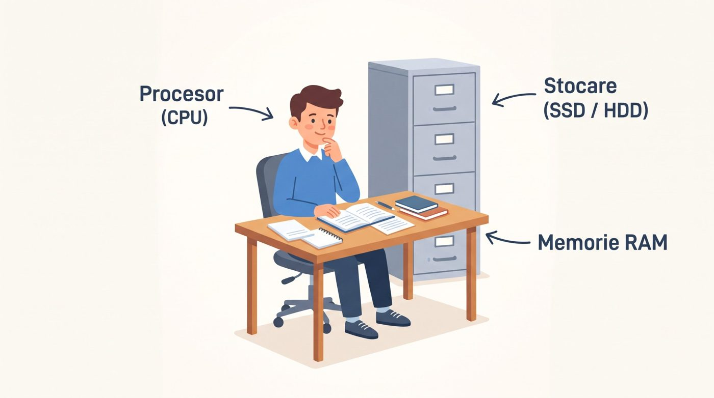
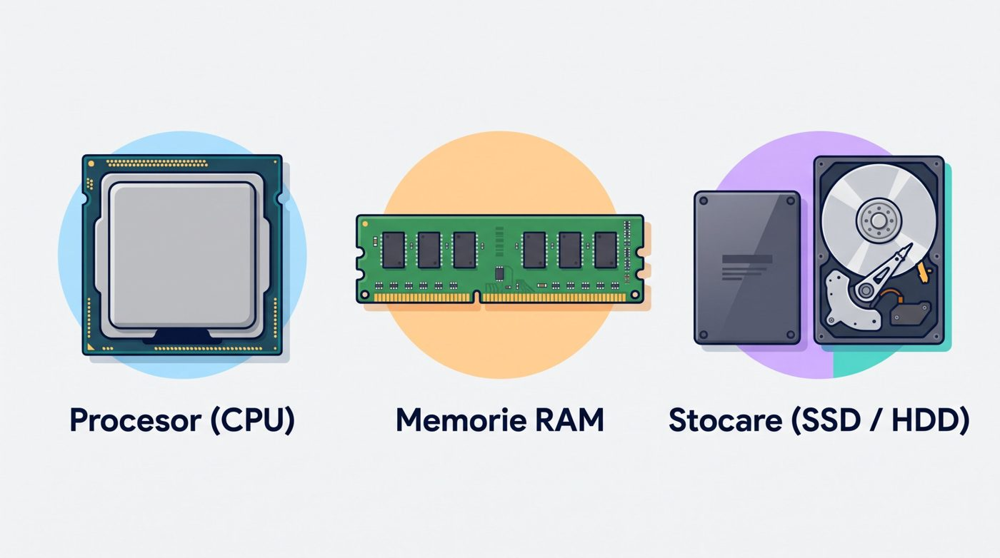
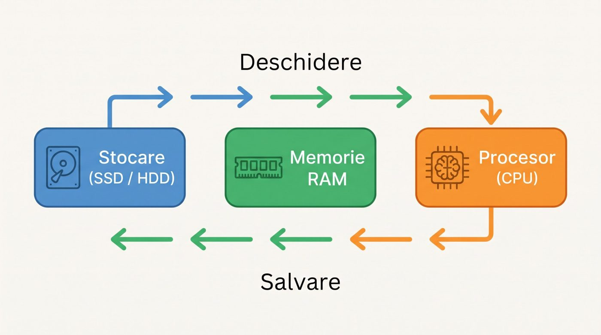

Un calculator pare complicat, dar la bază are trei părți care fac aproape tot. Azi le înveți pe rând, cu exemple simple. La final îți verifici singur ce ai înțeles.

**Ce vei învăța:**

- ce face procesorul
- ce face memoria RAM
- ce face stocarea
- cum lucrează toate trei când deschizi un document

## Analogia

Imaginează-ți că îți faci tema la un birou.

- **Tu** citești, gândești și scrii. Ești procesorul.
- **Masa** are loc doar pentru câteva caiete deschise. E memoria RAM.
- **Dulapul** păstrează toate caietele, chiar și când pleci. E stocarea.

Dacă masa e mică, te ridici des la dulap și lucrezi mai greu. La fel se întâmplă și într-un calculator.

## Definiția tehnică

**Procesorul (CPU)** este partea care execută instrucțiunile și face calculele. CPU vine de la *Central Processing Unit*, adică „unitatea centrală de procesare”. Cu cât este mai rapid, cu atât termină mai repede ce îi ceri.

**Memoria RAM** păstrează programele deschise și datele de care ai nevoie chiar acum. Procesorul ajunge la ele foarte repede. RAM este **volatilă**: când oprești calculatorul, tot ce era în ea dispare.

**Stocarea** păstrează fișierele pe termen lung: sistemul de operare, programele, pozele, documentele. Este **non-volatilă**: datele rămân și când calculatorul e oprit. Stocarea poate fi de două feluri:

- **HDD** (*hard disk*): are discuri care se rotesc. Este mai lent.
- **SSD**: are cipuri, fără piese în mișcare. Este mult mai rapid.

> [!NOTE]
> **Ține minte:** procesorul *lucrează*, RAM *ține ce folosești acum*, stocarea *păstrează tot, pe termen lung*.

## Exemplu pas cu pas

Vezi ce se întâmplă când deschizi un document, scrii în el și îl salvezi:

1. Dai dublu clic pe document.
2. Programul de scris și documentul sunt copiate din stocare în RAM.
3. Procesorul citește din RAM și afișează documentul pe ecran.
4. Scrii câteva rânduri. Ele apar doar în RAM, nu și pe stocare.
5. Apeși **Salvează**. Versiunea nouă este copiată din RAM înapoi pe stocare.
6. Închizi programul. RAM se eliberează, iar documentul rămâne în siguranță pe stocare.

> [!TIP]
> De asta pierzi ce ai scris dacă se ia curentul înainte să salvezi. Modificările erau doar în RAM.

## Unde greșesc toți

- **„Nu mai am memorie.”** Poate fi vorba de două lucruri diferite. Dacă nu mai ai loc pentru poze și filme, ți s-a umplut *stocarea*. Dacă telefonul se blochează cu multe aplicații deschise, ți s-a umplut *RAM*.
- **„Mai mult RAM înseamnă mereu un calculator mai rapid.”** Nu neapărat. Dacă masa e destul de mare pentru ce faci, una și mai mare nu te ajută. Pentru calcule grele contează procesorul. Pentru pornirea rapidă a programelor contează un SSD în loc de HDD.
- **„Tot ce fac dispare când opresc calculatorul.”** Nu. Ce ai salvat rămâne pe stocare. Se pierde doar ce era în RAM și nu ai salvat.

## Verifică-te

Încearcă să răspunzi în minte, apoi apasă pe întrebare ca să vezi răspunsul.

1. Care componentă face calculele?

Procesorul (CPU).

2. Ce se întâmplă cu RAM când oprești calculatorul?

Se golește. RAM este volatilă și nu păstrează datele fără curent.

3. Unde rămâne un document salvat după ce oprești calculatorul?

Pe stocare (SSD sau HDD).

## Misiunea zilei

### Încălzire

Potrivește cele trei părți ale calculatorului cu o bucătărie: bucătarul, blatul de lucru și frigiderul. Care este care și de ce?

### Aplicare

Deschide setările calculatorului sau ale telefonului, la informații despre dispozitiv. Notează câtă **memorie RAM** are și câtă **stocare**. Care număr e mai mare?

### Provocare

Ai deschis foarte multe file în browser și calculatorul se mișcă greu. Ce crezi că se întâmplă între RAM și stocare? Indiciu: ce faci tu la birou când masa s-a umplut, dar mai ai de lucru?

**Ce urmează:** în Ziua 2 afli cum ține un calculator orice text, poză sau sunet doar cu zero și unu.
